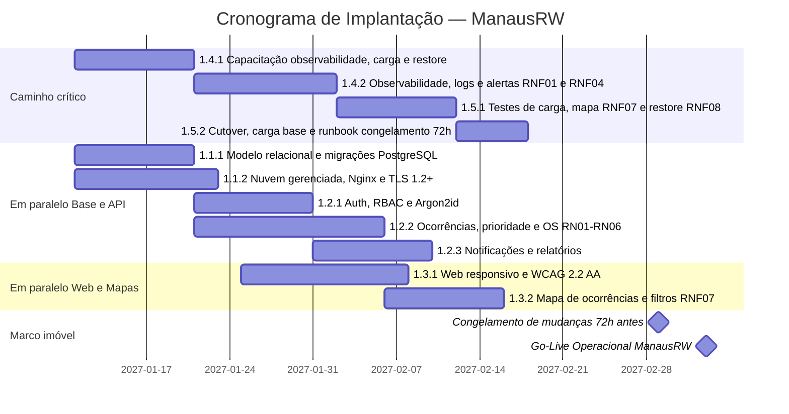

# Plano de Projeto — ManausRW (Etapa 2)

**Disciplina:** Projetos de Sistemas — CIESA  
**Sistema:** ManausRW — Monitoramento e Gestão de Ocorrências de Energia Elétrica  
**Autor / Responsável Técnico:** Raphael Max  
**Base arquitetural:** Etapa 1 (`README.md` — ADR-001, ADR-002, ADR-003, C4 N1–N3 e RN01–RN07)  
**Premissa geral de prazo e custo:** Todas as estimativas consideram dias úteis de trabalho (5 dias/semana), orçamento da frente dentro do teto de **R$ 1,2 milhão de investimento (CAPEX/implantação)** e **R$ 300 mil/ano de custeio (OPEX/operação)**, e janela de entrada em operação definida em calendário com congelamento de mudanças nas 72h anteriores ao go-live.

---

## 1. Tabela de impacto — seis ângulos por decisão arquitetural

### ADR-001: Aplicação web responsiva (HTML5, CSS3, JavaScript) em vez de app nativo Android/iOS

| Dimensão | Análise da decisão (ADR-001) |
|---|---|
| **Escopo** | **Cria:** Frontend web responsivo com acessibilidade WCAG 2.2 AA (RF01–RF10, RNF05) e matriz de testes cross-browser/mobile (RNF06). **Elimina:** Desenvolvimento, publicação e manutenção paralela de aplicativos nativos para Android e iOS. |
| **Cronograma** | **Dependência:** Endpoints REST e autenticação da API devem estar estáveis para integração do frontend. **Paralelismo:** Desenvolvimento do frontend responsivo pode ocorrer em paralelo à modelagem do banco e ao núcleo da API (dentro da alocação sequencial/priorizada de **Raphael Max**). **Caminho crítico:** Integração ponta a ponta e auditoria/testes de desempenho (RNF01/RNF07) ficam no caminho crítico antes da homologação. |
| **Custo** | **Implantação:** ~R$ 45 mil (esforço de desenvolvimento web + auditoria WCAG 2.2 AA). **Operação (3 anos):** ~R$ 18 mil/ano (R$ 54 mil em 3 anos — manutenção única de base web). **Total em 3 anos:** ~R$ 99 mil. |
| **Riscos** | **Mitiga:** Risco de atraso duplo por manter duas bases nativas e fricção de instalação para cidadãos. **Cria:** Dependência de conectividade e latência de rede móvel em áreas de apagão ou conexão limitada (RNF07). **Resposta planejada:** Payload enxuto, paginação/filtro geográfico no mapa e fallback claro de erro de rede; **Gatilho:** Latência p95 acima de 5s no mapa com 1.000 ocorrências em teste (RNF07). |
| **Aquisições** | **Construir:** Interface web e componentes acessíveis. **Comprar/Usar:** Bibliotecas open-source (ex.: mapa baseado em OpenStreetMap) e provedor externo de e-mail/SMS (RF10). **Dependência de fornecedor:** Baixa no frontend; moderada na API de mapas/notificações (troca exige adaptar adaptadores/chaves de API). |
| **Equipe** | **Competência:** **Raphael Max** possui base em desenvolvimento web (HTML5, CSS3, JavaScript), necessitando capacitação/revisão direcionada nos critérios da WCAG 2.2 AA (RNF05). **Operação:** **Raphael Max** assume a sustentação e evolução da interface web após a implantação. |

### ADR-002: PostgreSQL como banco de dados relacional em vez de MongoDB

| Dimensão | Análise da decisão (ADR-002) |
|---|---|
| **Escopo** | **Cria:** Esquema relacional, migrações, regras de agrupamento de incidentes (RN05), fluxo de validação de OS (RN04), relatórios (RF11) e rotina automatizada de backup/restauração (RNF08). **Elimina:** Camada de modelagem de documentos não estruturados e reconciliação manual de referências entre ocorrências, OS e usuários. |
| **Cronograma** | **Dependência:** Esquema relacional e migrações precedem os módulos da API (Django ORM) e testes de restauração (RNF08). **Paralelismo:** Configuração do ambiente de nuvem e capacitação ocorrem antes/em paralelo à modelagem inicial conforme o plano de **Raphael Max**. **Caminho crítico:** Modelagem/migrações e validação de backup/restauração (RNF08) integram o caminho crítico de prontidão operacional. |
| **Custo** | **Implantação:** ~R$ 35 mil (modelagem, scripts de migração, índices e testes de restore). **Operação (3 anos):** ~R$ 42 mil/ano (R$ 126 mil em 3 anos — instância gerenciada + armazenamento de backups). **Total em 3 anos:** ~R$ 161 mil. |
| **Riscos** | **Mitiga:** Inconsistência em transições de status de OS (RN04), duplicidade desorganizada de chamados (RN05) e perda de dados sem restauração testada (RNF08). **Cria:** Gargalos de bloqueio ou consultas analíticas pesadas (RF11) em picos de registro de ocorrências (RNF01). **Resposta planejada:** Índices adequados, separação/otimização de consultas de relatório e testes de carga; **Gatilho:** Percentil 95 de consulta acima de 3s com 500 usuários simultâneos (RNF01). |
| **Aquisições** | **Construir:** Modelo de dados, regras transacionais e rotinas de aplicação. **Comprar:** Banco PostgreSQL gerenciado na nuvem e armazenamento de objetos para backups. **Dependência de fornecedor:** Moderada-alta no serviço gerenciado (migrar de provedor exige exportação/importação de dump, recriação de políticas e revalidação de RTO/RPO). |
| **Equipe** | **Competência:** **Raphael Max** domina SQL e modelagem relacional, necessitando capacitação prática em ajuste fino de índices/planos de execução e validação cronometrada de RPO/RTO (RNF08). **Operação:** **Raphael Max** opera e administra o banco de dados e as rotinas de backup/restore pós-go-live. |

### ADR-003: Nuvem gerenciada com redundância e backups automatizados em vez de servidor físico próprio

| Dimensão | Análise da decisão (ADR-003) |
|---|---|
| **Escopo** | **Cria:** Provisionamento de infraestrutura em nuvem, Nginx com HTTPS/TLS 1.2+ (RNF02), observabilidade/monitoramento de disponibilidade (RNF04), automação de backups (RNF08) e capacitação em operação/observabilidade. **Elimina:** Compra de servidores físicos locais, montagem de sala/rack, gerador/nobreak próprio e manutenção de hardware on-premise. |
| **Cronograma** | **Dependência:** Ambiente em nuvem e Nginx/TLS devem estar prontos antes do deploy integrado e testes de carga/disponibilidade. **Paralelismo:** Provisionamento de infraestrutura e desenvolvimento ocorrem dentro das janelas planejadas por **Raphael Max**. **Caminho crítico:** Provisionamento de ambiente seguro, observabilidade e testes de carga/restauração compõem o caminho crítico. |
| **Custo** | **Implantação:** ~R$ 60 mil (setup de ambiente, Nginx/TLS, observabilidade e capacitação técnica). **Operação (3 anos):** ~R$ 120 mil/ano (R$ 360 mil em 3 anos — instâncias redundantes, tráfego, mapas/notificações e backups). **Total em 3 anos:** ~R$ 420 mil. |
| **Riscos** | **Mitiga:** Ponto único de falha local e indisponibilidade por falta de energia no prédio durante apagões em Manaus (RNF04). **Cria:** Custo recorrente em nuvem, eventual contingenciamento orçamentário ou demora em processo de contratação pública (Lei 14.133/2021). **Resposta planejada:** Monitoramento de orçamento/alertas de consumo e contratação antecipada; **Gatilho:** Consumo projetado acima de 85% do teto ou contratação sem edital/processo aberto 90 dias antes do go-live. |
| **Aquisições** | **Construir:** Scripts de deploy, configuração do Nginx/TLS e painéis de observabilidade. **Comprar:** Serviços de nuvem gerenciada, serviço de mapas (OpenStreetMap) e provedor de e-mail/SMS. **Dependência de fornecedor:** Alta para o provedor de nuvem (reempacotamento de containers/serviços, reconfiguração de rede/TLS e migração de dados levariam semanas e retrabalho de IaC/deploy). |
| **Equipe** | **Competência:** **Raphael Max** possui conhecimentos de implantação web, mas precisa de capacitação em observabilidade em produção, testes de carga e contingência em nuvem. **Operação:** **Raphael Max** assume o monitoramento contínuo de disponibilidade (RNF04), gestão de incidentes e sustentação em produção. |

---

## 2. Entregáveis da Etapa 2

### 2.1 Escopo e EAP (3+ níveis)

A EAP nasce diretamente das decisões da Etapa 1 (**ADR-001**, **ADR-002**, **ADR-003**) e dos requisitos vinculados (**RF01–RF12**, **RNF01–RNF08**, **RN01–RN07**), incluindo **pacotes de transição** (capacitação, observabilidade e migração/implantação) e **pacotes eliminados**.

#### Pacotes eliminados pelas decisões de arquitetura
* **Aquisição e instalação de servidores físicos locais, nobreaks e infraestrutura de sala/rede on-premise** (eliminado pela **ADR-003** — uso de nuvem gerenciada com redundância).
* **Desenvolvimento e manutenção de aplicativos nativos Android e iOS** (eliminado pela **ADR-001** — aplicação web responsiva multiplataforma).
* **Modelagem de documentos não estruturados / adaptação de queries NoSQL para relações e relatórios** (eliminado pela **ADR-002** — PostgreSQL relacional).

#### Estrutura Analítica do Projeto (EAP) — 3 níveis

```mermaid
flowchart TD
    ROOT["1. Projeto ManausRW"] --> P1["1.1 Arquitetura, Dados e Segurança - ADR-002 e ADR-003"]
    ROOT --> P2["1.2 API e Regras de Negócio - Django/DRF"]
    ROOT --> P3["1.3 Interface Web e Mapas - ADR-001"]
    ROOT --> P4["1.4 Transição: Capacitação e Observabilidade"]
    ROOT --> P5["1.5 Transição: Migração, Cutover e Validação"]

    P1 --> P1_1["1.1.1 Modelo relacional e migrações PostgreSQL"]
    P1 --> P1_2["1.1.2 Provisionamento nuvem, Nginx e TLS 1.2+"]
    P1 --> P1_3["1.1.3 Rotina de backup e teste de restore - RNF08"]

    P2 --> P2_1["1.2.1 Auth, RBAC e hash Argon2id - RF01-02, RF12, RNF03"]
    P2 --> P2_2["1.2.2 Ocorrências, prioridade e OS - RF03-09, RN01-06"]
    P2 --> P2_3["1.2.3 Notificações e relatórios - RF10-11, RN07"]

    P3 --> P3_1["1.3.1 Portal web responsivo e WCAG 2.2 AA - RNF05-06"]
    P3 --> P3_2["1.3.2 Mapa de ocorrências e filtros - RF05, RNF07"]

    P4 --> P4_1["1.4.1 Capacitação: observabilidade, carga e restore"]
    P4 --> P4_2["1.4.2 Telemetria, logs, alertas e SLAs - RNF01, RNF04"]

    P5 --> P5_1["1.5.1 Testes de carga e compatibilidade - RNF01, RNF06-07"]
    P5 --> P5_2["1.5.2 Carga de dados base, cutover e runbook operacional"]
```

---

### 2.2 Cronograma, dependências, paralelismo e caminho crítico

#### Dependências impostas pela arquitetura e pelo domínio
* **1.4.1 Capacitação → 1.4.2 Observabilidade e 1.5.1 Testes:** **Raphael Max** precisa concluir a capacitação nas ferramentas de observabilidade, testes de carga e restauração antes de instrumentar métricas confiáveis e executar testes de estresse.
* **1.1.1 Modelo PostgreSQL → 1.2.1 e 1.2.2 API (Auth, Ocorrências, OS):** A API depende das entidades, chaves e restrições de integridade (ADR-002) para persistir ocorrências, prioridades (RN01/RN02/RN06) e validações de OS (RN04).
* **1.1.2 Nuvem, Nginx e TLS → 1.4.2 Observabilidade e 1.5.2 Cutover:** A terminação HTTPS/TLS (RNF02) e o ambiente redundante (ADR-003) são pré-requisitos para homologar tráfego seguro e realizar o corte de produção.
* **1.2.2 API de Ocorrências e OS → 1.3.2 Mapa de ocorrências:** A exibição geográfica e o acompanhamento dependem dos endpoints e da classificação/agrupamento de ocorrências (RF05, RN05).
* **1.4.2 Observabilidade + 1.3.2 Mapa/Frontend → 1.5.1 Testes de carga e desempenho:** Só faz sentido medir p95 de consulta (RNF01) e carregamento do mapa (RNF07) com telemetria ativa e integração completa.
* **1.5.1 Testes e validação → 1.5.2 Cutover e operação:** O corte para produção exige aprovação de RNF01–RNF08 e ocorre antes do **marco imóvel de entrada em operação**, respeitando **congelamento de mudanças de 72 horas** antes do marco.

#### Caminho crítico, paralelismo e marcos imóveis
* **Caminho crítico:** `1.4.1 Capacitação` → `1.4.2 Observabilidade e alertas` → `1.5.1 Testes de carga, mapa e restore` → `1.5.2 Cutover e runbook` → **Marco imóvel: Go-Live Operacional ManausRW** (com congelamento de mudanças 72h antes).
* **Em paralelo:** `1.1.1 Modelo PostgreSQL` e `1.1.2 Nuvem/Nginx/TLS` avançam em paralelo à `1.4.1 Capacitação`; `1.2.1/1.2.2/1.2.3 API` e `1.3.1/1.3.2 Frontend/Mapa` avançam em frentes paralelas após a base de dados/contratos iniciais.
* **Marco imóvel:** **Go-Live Operacional do ManausRW** (data fixa do calendário; em caso de atraso crítico, o escopo de funcionalidades secundárias é reduzido ou adiado, nunca se sacrifica segurança TLS/Argon2id ou estabilidade mínima).

---

### 2.3 Custo em três anos (implantação vs. operação)

**Premissas:** Valores estimados em reais (R$) para o cenário do ManausRW, respeitando os limites de **R$ 1,2 mi de implantação** e **R$ 300 mil/ano de custeio**. A **Alternativa A** prioriza nuvem gerenciada com alta redundância multi-AZ e suporte/observabilidade gerenciada ampliada (ADR-003); a **Alternativa B** adota nuvem gerenciada enxuta com redundância essencial, autosserviço de monitoramento e políticas rigorosas de retenção/arquivamento de logs e backups (ADR-003).

| Alternativa | Implantação | Operação / Ano | Total em 3 anos |
|---|---|---|---|
| **Alternativa A — Nuvem redundante alta disponibilidade (multi-AZ + observabilidade ampliada)** | R$ 140.000 | R$ 180.000 | **R$ 680.000** |
| **Alternativa B — Nuvem gerenciada enxuta (redundância essencial + retenção otimizada)** | R$ 110.000 | R$ 115.000 | **R$ 455.000** |

**Premissas de custo:**
* *Implantação (Alt. A / Alt. B):* Inclui engenharia de software, modelagem PostgreSQL, configuração Nginx/TLS, capacitação técnica de **Raphael Max** e testes de carga/restauração; a Alt. A inclui configuração adicional de redundância multi-AZ e pacotes de observabilidade avançada.
* *Operação/ano:* Inclui instâncias em nuvem, banco PostgreSQL gerenciado, armazenamento de backups (RNF08), consultas de mapas e envio de notificações (RF10). A Alt. B reduz o custeio anual usando instâncias dimensionadas com margem controlada, escalonamento sob demanda e retenção escalonada de logs, mantendo-se bem abaixo do teto de R$ 300 mil/ano e do risco de contingenciamento orçamentário.

---

### 2.4 Estimativa dos pacotes principais (PERT)

Fórmulas aplicadas:
$$\text{PERT} = \frac{O + 4M + P}{6}, \qquad \text{Desvio } (\sigma) \approx \frac{P - O}{6}$$

| Pacote principal | Otimista ($O$) | Mais Provável ($M$) | Pessimista ($P$) | PERT (dias) | Desvio $\sigma$ (dias) | Ligação da cauda pessimista ($P$) ao risco/arquitetura |
|---|---|---|---|---|---|---|
| **1.1 Base de dados, nuvem, TLS e backup** | 8d | 12d | 24d | **13,3d** | 2,7d | Ajustes de esquema/índices (ADR-002), configuração TLS/Nginx e falhas em testes de restore (RNF08). |
| **1.2 API Django/DRF e regras de negócio** | 12d | 18d | 32d | **19,3d** | 3,3d | Complexidade nas regras de prioridade crítica (RN01/RN06), agrupamento (RN05) e validação de OS (RN04). |
| **1.3 Interface web responsiva e mapa** | 10d | 15d | 28d | **16,7d** | 3,0d | Ajustes de acessibilidade WCAG 2.2 AA (RNF05) e otimização de renderização de 1.000 pontos no mapa (RNF07). |
| **1.4 Capacitação e observabilidade** | 14d | 22d | 36d | **23,0d** | 3,7d | Curva de aprendizado de **Raphael Max** em observabilidade, testes de carga e automação de alertas. |
| **1.5 Testes de carga, cutover e runbook** | 8d | 14d | 26d | **15,0d** | 3,0d | Gargalos de p95 em 500 usuários simultâneos (RNF01) ou ajustes de permissão/dados no corte. |

---

### 2.5 Riscos (origem, resposta, gatilho e reservas)

* **Risco 1 — Gargalo de desempenho no banco ou na API com 500 usuários simultâneos ou 1.000 ocorrências no mapa (RNF01/RNF07)**
  * **Origem:** Arquitetural (ADR-002 / integração de mapas).
  * **Resposta planejada:** *Mitigar* — adicionar índices compostos, paginação/clustering espacial no mapa e cache de consultas frequentes antes do go-live.
  * **Gatilho:** Percentil 95 acima de 3s nas consultas ou acima de 5s no carregamento do mapa durante o teste de carga (pacote 1.5.1).
  * **Reserva:** Contingência (linha de base).
* **Risco 2 — Atraso na contratação pública de nuvem, mapas ou notificações sob a Lei 14.133/2021**
  * **Origem:** Projeto / Aquisições.
  * **Resposta planejada:** *Mitigar / Transferir* — iniciar instrução processual com antecedência mínima de 90 dias e prever ambiente de homologação/contingência caso o contrato sofra impugnação ou atraso.
  * **Gatilho:** Processo licitatório/contratação sem publicação ou sem assinatura a 60 dias do marco de cutover.
  * **Reserva:** Contingência (linha de base).
* **Risco 3 — Falha na restauração de backup ou perda de consistência em transições de ordem de serviço (RN04 / RNF08)**
  * **Origem:** Arquitetural / Operacional (ADR-002 e ADR-003).
  * **Resposta planejada:** *Mitigar* — executar teste cronometrado de restauração antes da entrada em produção e aplicar máquina de estados transacional na validação de OS (RN04).
  * **Gatilho:** Tempo de restauração acima de 4 horas no teste (RNF08) ou divergência de estado em teste de integração.
  * **Reserva:** Contingência (linha de base).
* **Risco 4 — Lacuna de domínio prático de Raphael Max em observabilidade, testes de carga ou acessibilidade WCAG 2.2 AA**
  * **Origem:** Equipe.
  * **Resposta planejada:** *Mitigar* — executar pacote de capacitação prática (1.4.1) com revisão técnica e checklist WCAG antes da fase de testes.
  * **Gatilho:** Avaliação prática ou auditoria inicial apontando lacuna crítica a 15 dias do término da capacitação.
  * **Reserva:** Contingência (linha de base).
* **Risco 5 — Corte orçamentário ou contingenciamento de custeio na administração pública durante o ano fiscal**
  * **Origem:** Projeto / Orçamento.
  * **Resposta planejada:** *Aceitar com plano de contingência* — manter operação na Alternativa B (custeio enxuto) e acionar revisão de prioridades com a direção caso haja bloqueio orçamentário inesperado.
  * **Gatilho:** Comunicação oficial de contingenciamento ou bloqueio de dotação orçamentária de custeio.
  * **Reserva:** Gerencial (direção).

---

### 2.6 Aquisições (construir vs. comprar e Lei 14.133/2021)

* **Construir:** Toda a aplicação do **ManausRW** — frontend web responsivo (HTML5/CSS3/JS), API REST em Python/Django/DRF com todas as regras de negócio (RF01–RF12, RN01–RN07), esquema relacional PostgreSQL, scripts de automação/deploy e painéis de observabilidade.
* **Comprar / Contratar:**
  1. **Infraestrutura em nuvem gerenciada e armazenamento de backups** (ADR-003, RNF04, RNF08).
  2. **Serviço cartográfico baseado em OpenStreetMap** (RF05, RNF07).
  3. **Provedor externo de envio de e-mail/SMS** (RF10, RN07).
* **Prazo de contratação (Lei 14.133/2021):** Considera-se **no mínimo 90 dias** para elaboração de termo de referência/estudo técnico, tramitação, eventual fase licitatória/contratação e habilitação sob a Lei 14.133/2021.
* **Dependência de fornecedor (vendor lock-in) e custo de saída:** A maior dependência está no **provedor de nuvem gerenciada** (ADR-003). Sair desse fornecedor após a implantação exigiria:
  * *Tempo:* 4 a 8 semanas para recriar infraestrutura, políticas de rede/TLS, pipelines e revalidar RNF01/RNF04/RNF08.
  * *Custo:* ~R$ 50 mil a R$ 90 mil em esforço de engenharia e transferência/validação de dados.
  * *O que seria reescrito:* Scripts/configurações de provisionamento em nuvem, políticas de IAM/backup e integrações específicas de monitoramento/notificação do provedor (o código da aplicação Django/DRF e o esquema SQL do PostgreSQL permanecem reutilizáveis).

---

### 2.7 Recursos humanos, operação e leis de engenharia

#### Responsáveis por execução e operação pós-implantação
* **Raphael Max — Arquiteto, Desenvolvedor Full-Stack e Engenheiro de Operações (Sustentação):**
  * *Na implantação:* Conduz arquitetura e contratos REST, modelagem PostgreSQL, desenvolvimento backend (Python/Django/DRF), interface web responsiva (HTML5/CSS3/JS com WCAG 2.2 AA), provisionamento em nuvem/Nginx/TLS, instrumentação de observabilidade e testes de carga, compatibilidade e restauração.
  * *Na operação pós-go-live:* Assume a operação técnica contínua do **ManausRW**, incluindo monitoramento de disponibilidade (RNF04), gestão de incidentes técnicos, rotina de backups/restauração (RNF08), atualizações de segurança e evolução de código.
* **Operador Público e Administrador do Sistema (usuários-chave do órgão público):**
  * *Na operação pós-go-live:* Operam o fluxo funcional diário do sistema — classificação de gravidade, despacho de ordens de serviço, validação de restabelecimentos (RN04), gestão de usuários internos (RF12) e emissão de relatórios (RF11).

#### Aplicação das leis e capacitação
* **Lei de Brooks:** Como o projeto é conduzido individualmente por **Raphael Max**, adicionar pessoas tardiamente a pacotes atrasados (como API ou testes de carga) exigiria transferência de contexto, alinhamento de contratos e revisão de código, atrasando ainda mais a entrega; em caso de gargalo, prioriza-se reduzir escopo não essencial ou adiar relatórios secundários, preservando o prazo do marco imóvel.
* **Lei de Conway:** Mesmo em uma atuação concentrada em **Raphael Max**, manter fronteiras modulares bem definidas entre apresentação web, API/regras de negócio, persistência PostgreSQL e infraestrutura/observabilidade evita acoplamento indevido e facilita a manutenção futura ou futura divisão entre especialistas.
* **Competência ausente como pacote de trabalho:** O pacote **1.4.1 Capacitação** (observabilidade em produção, testes de carga, acessibilidade WCAG 2.2 AA e restauração cronometrada de banco de dados) cobre as lacunas técnicas de **Raphael Max**, possui duração estimada (PERT de 23,0 dias, com 10 dias no cronograma inicial), custo incluído na implantação e posição explícita no **caminho crítico** antes da observabilidade e dos testes finais.