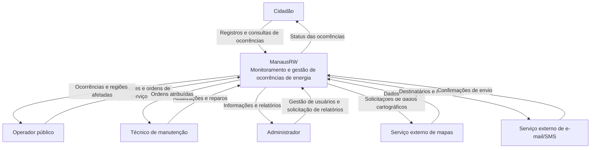
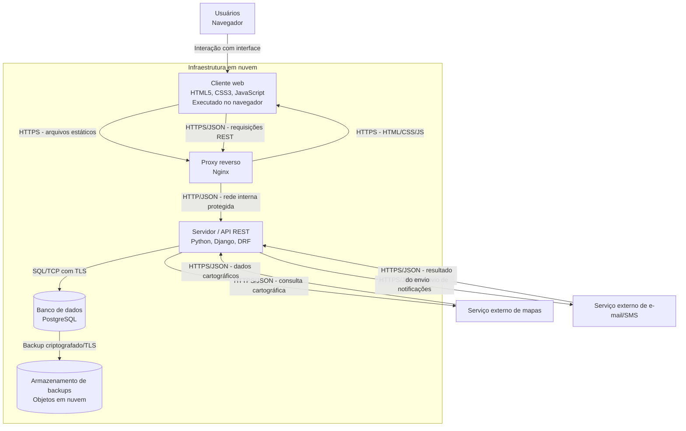
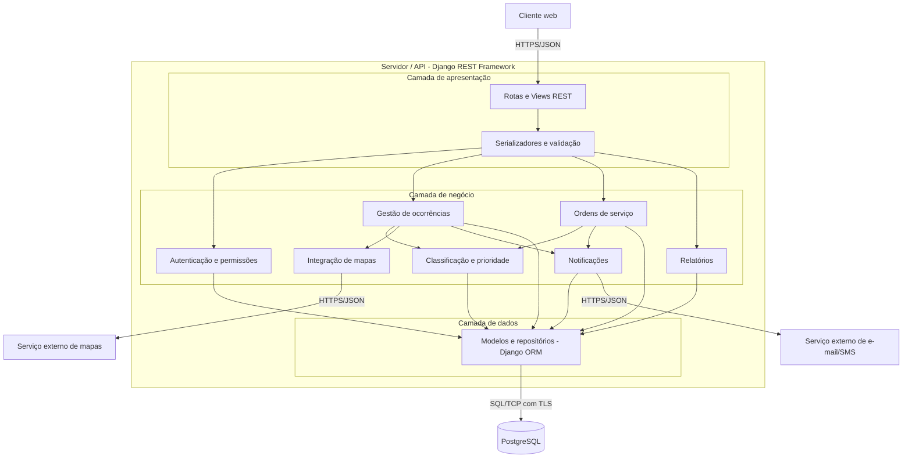
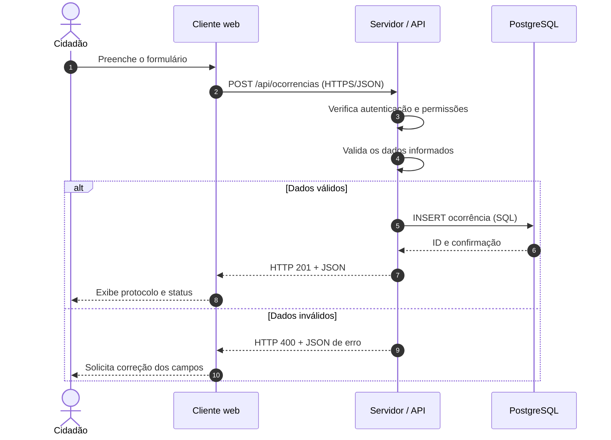

# ManausRW — Sistema de Monitoramento e Gestão de Ocorrências de Energia Elétrica

**Disciplina:** Projetos de Sistemas — CIESA  
**Modalidade:** Trabalho individual  
**Natureza:** Projeto conceitual, sem implementação
**Autor: Raphael Max** 

## Parte 1 — Levantamento e classificação de requisitos

### 1.1 Descrição do sistema

O **ManausRW** é um sistema fictício de monitoramento e gerenciamento de ocorrências relacionadas ao fornecimento de energia elétrica em Manaus (AM). Seu objetivo é apoiar órgãos públicos e equipes responsáveis pela manutenção na identificação, no registro e no acompanhamento de apagões e falhas de distribuição. Por meio de uma plataforma web, cidadãos podem comunicar interrupções e acompanhar seus chamados; operadores públicos podem consultar regiões afetadas, classificar a gravidade e encaminhar ordens de serviço; técnicos podem consultar tarefas e registrar reparos; e administradores podem gerenciar usuários, permissões e relatórios. O sistema apoia a coordenação operacional, mas não controla diretamente a rede elétrica nem substitui a concessionária responsável.

### 1.2 Tipos de usuário

| Usuário | Responsabilidade |
|---|---|
| Cidadão | Registra interrupções e acompanha ocorrências próprias. |
| Operador público | Analisa ocorrências, classifica gravidade e encaminha ordens de serviço. |
| Técnico de manutenção | Consulta ordens atribuídas e registra andamento e reparos. |
| Administrador | Gerencia usuários internos, permissões e relatórios. |

### 1.3 Requisitos funcionais (RF)

| Código | Tipo | Descrição | Prioridade |
|---|---|---|---|
| RF01 | Funcional | O sistema deve permitir que o cidadão realize seu cadastro informando nome, e-mail e senha. | Alta |
| RF02 | Funcional | O sistema deve permitir que os usuários cadastrados realizem autenticação por e-mail e senha. | Alta |
| RF03 | Funcional | O sistema deve permitir que o cidadão registre uma ocorrência de falta de energia informando endereço, data, horário e descrição do problema. | Alta |
| RF04 | Funcional | O sistema deve permitir que o cidadão consulte o andamento das ocorrências registradas por ele. | Alta |
| RF05 | Funcional | O sistema deve permitir que o operador público visualize em um mapa as ocorrências de interrupção de energia registradas em Manaus. | Alta |
| RF06 | Funcional | O sistema deve permitir que o operador público classifique as ocorrências de acordo com seu nível de gravidade. | Alta |
| RF07 | Funcional | O sistema deve permitir que o operador público crie ordens de serviço e as encaminhe aos técnicos responsáveis pela manutenção. | Alta |
| RF08 | Funcional | O sistema deve permitir que o técnico de manutenção consulte as ordens de serviço atribuídas a ele. | Alta |
| RF09 | Funcional | O sistema deve permitir que o técnico de manutenção atualize o status da ordem de serviço e registre informações sobre o reparo realizado. | Alta |
| RF10 | Funcional | O sistema deve permitir que o cidadão receba notificações quando houver alterações na situação de suas ocorrências. | Média |
| RF11 | Funcional | O sistema deve permitir que o administrador gere relatórios sobre ocorrências, regiões afetadas e tempo de resolução dos problemas. | Média |
| RF12 | Funcional | O sistema deve permitir que o administrador cadastre, edite, desative e configure as permissões dos usuários internos. | Alta |

### 1.4 Requisitos não funcionais (RNF)

| Código | Tipo | Categoria | Descrição mensurável | Prioridade |
|---|---|---|---|---|
| RNF01 | Não funcional | Desempenho | O sistema deve responder a 95% das requisições de consulta de ocorrências em até 3 segundos, com até 500 usuários simultâneos. | Alta |
| RNF02 | Não funcional | Segurança | O sistema deve utilizar HTTPS com TLS 1.2 ou superior em 100% das comunicações entre cliente e servidor. | Alta |
| RNF03 | Não funcional | Segurança | O sistema deve armazenar 100% das senhas com algoritmo de hash apropriado, como Argon2id, sem texto puro. | Alta |
| RNF04 | Não funcional | Disponibilidade | O sistema deve apresentar disponibilidade mínima de 99,5% ao mês, excluídas manutenções previamente programadas. | Alta |
| RNF05 | Não funcional | Usabilidade e acessibilidade | As interfaces de cadastro, autenticação e registro de ocorrências devem atender aos critérios aplicáveis do nível AA da WCAG 2.2. | Média |
| RNF06 | Não funcional | Compatibilidade | O sistema deve funcionar nas duas versões estáveis mais recentes de Google Chrome, Mozilla Firefox e Microsoft Edge, em computadores e dispositivos móveis. | Média |
| RNF07 | Não funcional | Desempenho | O mapa inicial deve carregar em até 5 segundos em 95% das tentativas, com até 1.000 ocorrências exibidas e conexão de pelo menos 10 Mbps. | Alta |
| RNF08 | Não funcional | Recuperação de dados | O sistema deve executar pelo menos um backup automático a cada 24 horas e permitir restauração em até 4 horas após falha crítica. | Alta |

#### Verificação dos RNFs

| Código | Forma de verificação |
|---|---|
| RNF01 | Teste de carga com 500 usuários simultâneos e medição do percentil 95 do tempo de resposta. |
| RNF02 | Inspeção de conexões HTTPS e configuração de versões TLS. |
| RNF03 | Inspeção do mecanismo de armazenamento e verificação do algoritmo de hash. |
| RNF04 | Monitoramento mensal de disponibilidade. |
| RNF05 | Auditoria de acessibilidade baseada na WCAG 2.2 AA. |
| RNF06 | Testes nas versões dos navegadores especificados. |
| RNF07 | Teste de carregamento do mapa nas condições descritas. |
| RNF08 | Inspeção de backups e teste cronometrado de restauração. |

### 1.5 Regras de negócio (RN)

Estas são políticas **propostas para o cenário fictício** e aplicáveis mesmo em um processo manual.

| Código | Tipo | Descrição | Prioridade |
|---|---|---|---|
| RN01 | Regra de negócio | Ocorrências que afetem hospitais, unidades de pronto atendimento e outros serviços públicos essenciais devem receber prioridade crítica. | Alta |
| RN02 | Regra de negócio | Toda ocorrência deve receber classificação baixa, média, alta ou crítica antes do encaminhamento à manutenção. | Alta |
| RN03 | Regra de negócio | Somente técnicos autorizados e habilitados para a intervenção podem executar serviços de manutenção na rede elétrica. | Alta |
| RN04 | Regra de negócio | Uma ordem de serviço só pode ser concluída após confirmação do reparo pelo técnico e validação do restabelecimento pelo operador responsável. | Alta |
| RN05 | Regra de negócio | Registros do mesmo local e da mesma interrupção devem ser tratados como um incidente operacional, preservando os registros individuais. | Média |
| RN06 | Regra de negócio | Ocorrências críticas devem ser encaminhadas à equipe responsável em até 10 minutos após confirmação da gravidade. | Alta |
| RN07 | Regra de negócio | Desligamentos programados devem ser comunicados aos órgãos públicos afetados com pelo menos 24 horas de antecedência, exceto em emergências. | Média |

### 1.6 Síntese

A Parte 1 define **12 RF, 8 RNF e 7 RN**, totalizando 27 requisitos. As metas de qualidade são verificáveis e servirão de base para as escolhas de arquitetura.

---

## Parte 2 — Documento de arquitetura

### 2.1 Visão geral

O ManausRW adota uma arquitetura cliente-servidor, organizada nas camadas de **apresentação**, **negócio** e **dados**. A aplicação web é acessada por navegador; a API executa regras e autorizações; o banco persiste os registros.

| Elemento | Tecnologia proposta | Justificativa |
|---|---|---|
| Cliente web | HTML5, CSS3, JavaScript | Acesso multiplataforma via navegador (RNF05, RNF06). |
| Servidor/API | Python, Django, Django REST Framework | Endpoints REST e regras de negócio (RF01–RF12). |
| Banco | PostgreSQL | Integridade relacional e relatórios (RF07, RF09, RF11). |
| Proxy reverso | Nginx | Entrega de arquivos e terminação HTTPS (RNF02). |
| Mapas | Serviço cartográfico baseado em OpenStreetMap | Visualização de regiões afetadas (RF05). |
| Notificações | Provedor externo de e-mail/SMS | Avisos de mudança de status (RF10). |
| Infraestrutura | Nuvem gerenciada, com redundância e backups | Disponibilidade e recuperação (RNF04, RNF08). |

### 2.2 Diagramas C4

#### 2.2.1 Nível 1 — Contexto

**Título:** Diagrama de contexto do ManausRW.



**Legenda:** retângulos representam pessoas, o sistema como unidade única e serviços externos. As setas indicam o conteúdo trafegado. Não há detalhamento interno neste nível.

**Rastreabilidade:** RF03, RF04, RF05, RF06, RF07, RF08, RF09, RF10, RF11 e RF12.

#### 2.2.2 Nível 2 — Contêineres

**Título:** Diagrama de contêineres do ManausRW.



**Legenda:** retângulos representam contêineres executáveis ou serviços externos; cilindros representam armazenamentos. Setas mostram protocolos e conteúdo. O cliente web executa no navegador; a representação no agrupamento indica que seus arquivos são hospedados na infraestrutura. O Nginx termina HTTPS e encaminha as chamadas à API por uma rede interna protegida.

**Rastreabilidade:** RF01–RF12, RNF01, RNF02, RNF04, RNF06, RNF07 e RNF08.

#### 2.2.3 Nível 3 — Componentes do servidor

**Título:** Diagrama de componentes da API do ManausRW.



**Legenda:** os retângulos internos representam módulos do servidor, organizados em apresentação, negócio e dados. Setas representam dependências ou comunicação. O PostgreSQL e os serviços externos aparecem apenas como dependências do contêiner detalhado.

| Componente | Responsabilidade | Requisitos |
|---|---|---|
| Rotas e validação | Receber, serializar e validar requisições. | RF01–RF12 |
| Autenticação e permissões | Identificar usuários e controlar perfis. | RF01, RF02, RF12, RNF03 |
| Gestão de ocorrências | Registrar, consultar e agrupar incidentes. | RF03, RF04, RF05, RN05 |
| Classificação e prioridade | Aplicar gravidade e critérios de atendimento. | RF06, RN01, RN02, RN06 |
| Ordens de serviço | Atribuir, atualizar e validar reparos. | RF07, RF08, RF09, RN03, RN04 |
| Integração de mapas | Obter dados cartográficos. | RF05, RNF07 |
| Notificações | Enviar avisos de status e desligamentos. | RF10, RN07 |
| Relatórios | Consultar indicadores e consolidar relatórios. | RF11 |
| Modelos e repositórios | Persistir registros e consultar dados. | RF01–RF12, RNF08 |

### 2.3 Registros de decisão arquitetural (ADRs)

#### ADR-001 — Adotar uma aplicação web responsiva

**Status:** aceita  
**Data:** 2026-11-06

##### Contexto

RF03, RF04 e RF05 exigem registro, consulta e visualização de ocorrências. RNF05 e RNF06 exigem acessibilidade e compatibilidade com navegadores e dispositivos.

##### Alternativas consideradas

**Alternativa A — Aplicação web responsiva**  
**A favor:** funciona pelo navegador, dispensa instalação e centraliza atualizações.  
**Contra:** depende de conectividade e tem acesso mais limitado a recursos específicos do dispositivo.

**Alternativa B — Aplicativo móvel nativo**  
**A favor:** integração direta com recursos do aparelho e possibilidade de funcionalidades offline.  
**Contra:** exige manutenção de versões para Android e iOS, aumentando o esforço do projeto.

##### Decisão

Escolhemos a **Alternativa A**, usando HTML5, CSS3 e JavaScript, para atender aos diferentes dispositivos sem exigir instalação.

##### Consequências

**Positivas:** maior alcance e manutenção centralizada.  
**Negativas:** dependência de internet e necessidade de testes em diferentes navegadores.

**Requisitos vinculados:** RF03, RF04, RF05, RNF05, RNF06.

#### ADR-002 — Utilizar PostgreSQL como banco de dados relacional

**Status:** aceita  
**Data:** 2026-11-06

##### Contexto

RF07, RF09 e RF11 envolvem relações entre usuários, ocorrências, ordens de serviço e relatórios. RN04 e RN05 exigem consistência e histórico, enquanto RNF08 exige recuperação dos dados.

##### Alternativas consideradas

**Alternativa A — PostgreSQL (relacional)**  
**A favor:** integridade referencial, transações e consultas SQL.  
**Contra:** exige definição do esquema, migrações e administração.

**Alternativa B — MongoDB (orientado a documentos)**  
**A favor:** esquema flexível e facilidade de armazenar documentos heterogêneos.  
**Contra:** relacionamentos e relatórios podem demandar modelagem adicional.

##### Decisão

Escolhemos a **Alternativa A**, porque os dados possuem relações estruturadas e exigem integridade e consultas consistentes.

##### Consequências

**Positivas:** integridade, transações confiáveis e consultas analíticas.  
**Negativas:** necessidade de migrações e rotinas de administração e backup.

**Requisitos vinculados:** RF07, RF09, RF11, RN04, RN05, RNF08.

#### ADR-003 — Hospedar o sistema em infraestrutura de nuvem gerenciada

**Status:** aceita  
**Data:** 2026-11-06

##### Contexto

RNF01 define capacidade de atendimento, RNF04 exige disponibilidade mensal e RNF08 estabelece backups e recuperação. A operação deve minimizar a dependência de uma única instalação local, especialmente em cenários de apagão.

##### Alternativas consideradas

**Alternativa A — Nuvem gerenciada com redundância**  
**A favor:** monitoramento, expansão de recursos e automação de backups.  
**Contra:** custos recorrentes, dependência do provedor e necessidade de configuração adequada.

**Alternativa B — Servidor físico próprio**  
**A favor:** controle direto do equipamento e da infraestrutura.  
**Contra:** investimento inicial, manutenção, redundância e energia de emergência sob responsabilidade local.

##### Decisão

Escolhemos a **Alternativa A**, com recursos redundantes, monitoramento e backups automatizados, para apoiar os objetivos de disponibilidade e recuperação.

##### Consequências

**Positivas:** escalabilidade e facilidade de implantar redundância e backups.  
**Negativas:** custos contínuos, dependência de fornecedores e necessidade de monitorar o consumo.

**Requisitos vinculados:** RNF01, RNF04, RNF08.

### 2.4 Comunicação cliente-servidor

#### 2.4.1 Diagrama de sequência — Registro de ocorrência

**Título:** Fluxo de registro de ocorrência com sucesso e erro.



**Legenda:** setas contínuas indicam requisições; tracejadas indicam respostas. O bloco `alt` representa caminhos alternativos. **Requisitos:** RF02, RF03 e RNF02.

#### 2.4.2 Quatro requisições HTTP

Os endereços e dados são ilustrativos; o domínio `.exemplo` não é um serviço real.

##### 1. POST — Registrar ocorrência

**RF correspondente:** RF03  
**URL:** `https://api.manausrw.exemplo/api/ocorrencias`  
**Autenticação:** cidadão autenticado

**JSON enviado:**

```json
{
  "endereco": "Av. Constantino Nery, Manaus",
  "bairro": "Chapada",
  "data_ocorrencia": "2026-11-06",
  "hora_ocorrencia": "14:30",
  "descricao": "Interrupção de energia na região."
}
```

**Status da resposta:** `201 Created`

**JSON devolvido:**

```json
{
  "id": 105,
  "protocolo": "MRW-2026-0105",
  "bairro": "Chapada",
  "status": "registrada",
  "mensagem": "Ocorrência registrada com sucesso."
}
```

##### 2. GET — Consultar ocorrência

**RF correspondente:** RF04  
**URL:** `https://api.manausrw.exemplo/api/ocorrencias/105`  
**Autenticação:** autor da ocorrência ou usuário interno autorizado

**Status da resposta:** `200 OK`

**JSON devolvido:**

```json
{
  "id": 105,
  "protocolo": "MRW-2026-0105",
  "bairro": "Chapada",
  "data_ocorrencia": "2026-11-06",
  "hora_ocorrencia": "14:30",
  "gravidade": "alta",
  "status": "em_atendimento",
  "ultima_atualizacao": "2026-11-06T15:10:00-04:00"
}
```

##### 3. PUT — Atualizar ordem de serviço

**RF correspondente:** RF09  
**URL:** `https://api.manausrw.exemplo/api/ordens-servico/52`  
**Autenticação:** técnico autorizado e atribuído à ordem

**JSON enviado:**

```json
{
  "status": "reparo_realizado",
  "descricao_reparo": "Substituição de componente danificado.",
  "data_reparo": "2026-11-06",
  "hora_reparo": "16:20"
}
```

**Status da resposta:** `200 OK`

**JSON devolvido:**

```json
{
  "id": 52,
  "ocorrencia_id": 105,
  "status": "aguardando_validacao",
  "mensagem": "Reparo registrado. Aguardando validação do operador."
}
```

O corpo representa a atualização completa dos campos editáveis pelo técnico neste recurso. Conforme RN04, a ordem não é concluída antes da validação do operador.

##### 4. DELETE — Desativar usuário interno

**RF correspondente:** RF12  
**URL:** `https://api.manausrw.exemplo/api/usuarios-internos/87`  
**Autenticação:** administrador

A exclusão é **lógica**: a conta é desativada e os registros históricos são preservados.

**Status da resposta no caso de erro:** `403 Forbidden`

**JSON devolvido:**

```json
{
  "erro": "acesso_negado",
  "mensagem": "Somente administradores podem desativar usuários internos.",
  "status": 403
}
```

**Resposta alternativa de sucesso:** `204 No Content`, sem corpo JSON, quando o administrador autorizado realiza a operação.

#### 2.4.3 HTTPS e TLS

O ManausRW deve proteger credenciais, dados de cadastro, endereços, detalhes das ocorrências, ordens de serviço e informações administrativas durante o tráfego entre cliente e servidor.

O protocolo **HTTPS**, utilizando **TLS 1.2 ou superior** (RNF02), fornece:

- **Confidencialidade:** criptografia do conteúdo transmitido.
- **Integridade:** detecção de alterações indevidas no trânsito.
- **Autenticidade:** validação da identidade do servidor por certificado digital corretamente verificado.

Além disso, o sistema aplica controle de acesso por perfil e armazenamento seguro de senhas com Argon2id (RNF03). HTTPS não substitui a autorização dos usuários nem a proteção de dados armazenados. As integrações externas usam HTTPS, e a conexão ao PostgreSQL utiliza TLS.

### 2.5 Rastreabilidade

#### 2.5.1 RNF → decisão arquitetural

| RNF | Decisão / elemento C4 | Justificativa |
|---|---|---|
| RNF01 | ADR-003; API Django e PostgreSQL (C4 N2) | Infraestrutura dimensionável e consultas otimizáveis permitem perseguir a meta de tempo de resposta. |
| RNF02 | Nginx e HTTPS/TLS (C4 N2) | Protege a comunicação cliente-servidor. |
| RNF03 | Autenticação com Argon2id (C4 N3) | Aplica hash seguro às senhas armazenadas. |
| RNF04 | ADR-003; infraestrutura redundante (C4 N2) | Reduz pontos únicos de falha e possibilita monitoramento. |
| RNF05 | ADR-001; cliente web (C4 N2) | Permite implementar interface acessível conforme WCAG 2.2 AA. |
| RNF06 | ADR-001; HTML5/CSS3/JS (C4 N2) | Permite testar compatibilidade nos navegadores exigidos. |
| RNF07 | Integração de mapas (C4 N3) | Consultas por região e limitação dos dados ajudam no carregamento do mapa. |
| RNF08 | ADR-002 e ADR-003; backups em nuvem (C4 N2) | Permitem automatizar cópias e executar restauração. |

As decisões propostas **não garantem automaticamente** as metas: o cumprimento deve ser demonstrado pelos testes definidos na Parte 1.

#### 2.5.2 HTTP → requisito funcional

| Método | Endpoint | RF | Correspondência |
|---|---|---|---|
| POST | `/api/ocorrencias` | RF03 | Registrar ocorrência. |
| GET | `/api/ocorrencias/105` | RF04 | Consultar ocorrência própria. |
| PUT | `/api/ordens-servico/52` | RF09 | Atualizar reparo e andamento. |
| DELETE | `/api/usuarios-internos/87` | RF12 | Desativar usuário interno. |

#### 2.5.3 RN → componente responsável

| RN | Componente (C4 N3) | Aplicação |
|---|---|---|
| RN01 | Classificação e prioridade | Prioridade crítica para serviços essenciais. |
| RN02 | Classificação e prioridade | Classificação obrigatória antes do encaminhamento. |
| RN03 | Autenticação e ordens de serviço | Restrições por autorização e habilitação. |
| RN04 | Ordens de serviço | Validação do operador antes da conclusão. |
| RN05 | Gestão de ocorrências | Agrupamento de registros relacionados. |
| RN06 | Classificação e ordens de serviço | Controle de prazo de encaminhamento crítico. |
| RN07 | Notificações | Avisos prévios de desligamentos programados. |

### 2.6 Considerações finais

A arquitetura do ManausRW deriva dos requisitos declarados na Parte 1. Os diagramas C4 representam o sistema em três níveis de abstração, os ADRs registram escolhas com alternativas e consequências, e os exemplos HTTP ilustram a comunicação cliente-servidor. As tabelas de rastreabilidade vinculam os RNFs a decisões e todas as requisições HTTP a requisitos funcionais. Assim, a proposta apoia a organização dos atendimentos, a comunicação com a população e a priorização de serviços essenciais em situações de interrupção de energia em Manaus.

